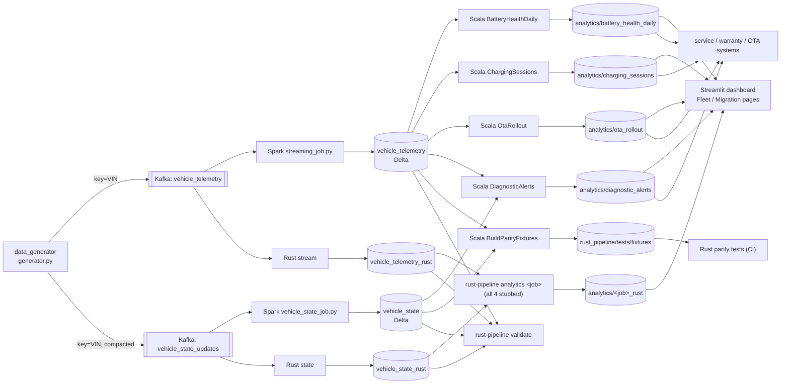

# Dependencies

Derived from the job sources listed in `inventory.md`. Line citations are to `main`.

## Data flow: Kafka topics to consumers

Sources: generator → topics `data_generator/generator.py:272-273`; Spark streams `spark_jobs/streaming_job.py:187-195,240-247`, `spark_jobs/vehicle_state_job.py:160-172,120-143`; Rust streams `deploy/k8s/telemetry-stream.yaml:36`, `deploy/k8s/vehicle-state-stream.yaml:36`, `config/app_config.yaml:77-82`; analytics reads `spark_jobs/analytics/src/main/scala/telemetry/analytics/AnalyticsJob.scala:49-53` and each job's `build`; fixtures `spark_jobs/analytics/src/main/scala/telemetry/analytics/BuildParityFixtures.scala:19-44`; Rust analytics reads `rust_pipeline/src/analytics/mod.rs:84-87`; validate `README.md:115-145`; dashboard `dashboard/app.py:212-229,637-651,714`; external consumers `README.md:5-7`.

## Analytics jobs: reads, writes, shares

| Job | Reads (Spark → Rust) | Writes (Spark / Rust) | Partition | Shared **code** | Shared **data** |
|---|---|---|---|---|---|
| `battery_health_daily` | `vehicle_telemetry` → `vehicle_telemetry_rust` (`spark_jobs/analytics/src/main/scala/telemetry/analytics/BatteryHealthDaily.scala:43-44`) | `analytics/battery_health_daily` / `…_rust` (`rust_pipeline/src/config.rs:225-232`) | `event_date` | A, B, R | telemetry table; fixture `input/telemetry` |
| `charging_sessions` | `vehicle_telemetry` (`spark_jobs/analytics/src/main/scala/telemetry/analytics/ChargingSessions.scala:40-41`) | `analytics/charging_sessions` / `…_rust` | `session_date` | A, B, R | telemetry; `input/telemetry` |
| `ota_rollout` | `vehicle_telemetry` (`spark_jobs/analytics/src/main/scala/telemetry/analytics/OtaRollout.scala:46-47`) | `analytics/ota_rollout` / `…_rust` | — | A, B, R | telemetry; `input/telemetry` |
| `diagnostic_alerts` | `vehicle_telemetry` + `vehicle_state` → `…_rust` (`spark_jobs/analytics/src/main/scala/telemetry/analytics/DiagnosticAlerts.scala:36-40`) | `analytics/diagnostic_alerts` / `…_rust` | — | A, B, R | telemetry **and** vehicle_state; `input/telemetry`, `input/vehicle_state` |

Shared code legend:
- **A — Scala runtime:** `spark_jobs/analytics/src/main/scala/telemetry/analytics/AnalyticsJob.scala` (CLI, config, paths, Spark session incl. UTC timezone, Delta overwrite writer, `:8-97`) used by all four objects.
- **B — Parity fixture builder:** `spark_jobs/analytics/src/main/scala/telemetry/analytics/BuildParityFixtures.scala:19-24` calls every job's `summarize`; removing or renaming a Scala job breaks fixture regeneration.
- **R — Rust harness:** registry/dispatcher/writer `rust_pipeline/src/analytics/mod.rs:49-111`, fixture loader `rust_pipeline/src/analytics/parity.rs`, schema/row comparison and PII gate `rust_pipeline/src/validate.rs:19-23,185-243`, rounding helper `rust_pipeline/src/transforms/rounding.rs`, CLI `rust_pipeline/src/main.rs`, plus the consumers that list every job: `dashboard/app.py:178-207,464-468` and `scripts/load_demo_data.py:35-40`.

**No analytics job reads another analytics job's output**: every `build` reads only `paths.telemetry` and/or `paths.vehicleState` (`spark_jobs/analytics/src/main/scala/telemetry/analytics/BatteryHealthDaily.scala:43-44`, `spark_jobs/analytics/src/main/scala/telemetry/analytics/ChargingSessions.scala:40-41`, `spark_jobs/analytics/src/main/scala/telemetry/analytics/OtaRollout.scala:46-47`, `spark_jobs/analytics/src/main/scala/telemetry/analytics/DiagnosticAlerts.scala:36-40`). Upstream, all analytics depend on the enrichment in `spark_jobs/transforms.py:190-201` (e.g. `model_safe`, `event_date`, `thermal_alert`, `is_fault`, `vin_hash`).

## What can move independently, and what must move first

**Already moved (prerequisites satisfied):** the Rust analytics read `vehicle_telemetry_rust` and `vehicle_state_rust` (`rust_pipeline/src/analytics/mod.rs:84-87`), produced by the two Rust streams that are marked ported (`README.md:59-60`) and deployed (`deploy/k8s/kustomization.yaml:9-13`). Parity tests run on committed Spark fixtures, not live tables (`rust_pipeline/src/analytics/parity.rs`), so ports do not need a running cluster.

**Independent:** all four jobs. They share no output data, and the Rust registry and dispatcher already list every job so "porting a job only touches that job's file" (`rust_pipeline/src/analytics/mod.rs:9-10,49-78`). The dashboard flips a job to ported when its `#[ignore]` is removed (`dashboard/app.py:461-468`).

**Move first / coordinate:**
1. **A Spark-compat helper for `round` as a DataFusion expression.** Every job uses Spark `round` (`spark_jobs/analytics/src/main/scala/telemetry/analytics/BatteryHealthDaily.scala:20,23,39`, `spark_jobs/analytics/src/main/scala/telemetry/analytics/ChargingSessions.scala:19,28,35`, `spark_jobs/analytics/src/main/scala/telemetry/analytics/OtaRollout.scala:24`, `spark_jobs/analytics/src/main/scala/telemetry/analytics/DiagnosticAlerts.scala:32`), and the only helper is a scalar `f64` function (`rust_pipeline/src/transforms/rounding.rs:1-7`). Whichever slice lands first should add it in one shared place; otherwise parallel ports each invent their own and drift. This is the one exception to "only touches that job's file".
2. **`diagnostic_alerts` last**: it is the only job with a second input and relies on `vehicle_state_rust`'s schema and VIN hashing matching Spark (`spark_jobs/analytics/src/main/scala/telemetry/analytics/DiagnosticAlerts.scala:13-14`).
3. **Retiring Scala code comes after all ports**: `AnalyticsJob.scala` is shared by all four, and `BuildParityFixtures.scala` needs every Scala `summarize` to regenerate expected outputs (`spark_jobs/analytics/src/main/scala/telemetry/analytics/BuildParityFixtures.scala:19-24,55-59`). Individual Scala jobs should keep running until consumers (`dashboard/app.py:651`, `README.md:5-7`) are pointed at `<job>_rust`.

See `migration-slices.md` for the proposed slices.
