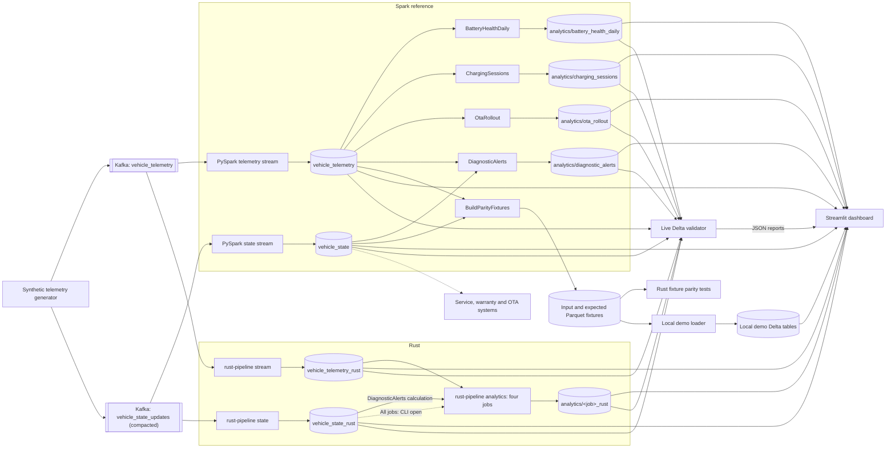

# Legacy pipeline dependencies

[Job inventory](inventory.md) · [Migration slices](migration-slices.md)

## Kafka to consumers

Solid arrows show data flow. The dashed arrow into Rust analytics shows the additional table opened by every CLI invocation before dispatch. The dashed arrow to external consumers shows the state lookup described by the driver. [Rust analytics runner](../../rust_pipeline/src/analytics/mod.rs#L80-L95) · [Vehicle-state consumer description](../../spark_jobs/vehicle_state_job.py#L1-L6)

- **Producer and streams.** The generator publishes VIN-keyed records to both topics. Compose creates and configures them. Spark uses the configured telemetry and state output paths. The Rust stream entry points consume the same topics and write the suffixed outputs. [generator.py · publishing](../../data_generator/generator.py#L242-L278) · [docker-compose.yml · Kafka setup](../../docker-compose.yml#L49-L89) · [spark_jobs/streaming_job.py](../../spark_jobs/streaming_job.py) · [spark_jobs/vehicle_state_job.py](../../spark_jobs/vehicle_state_job.py) · [rust_pipeline/src/consumer.rs](../../rust_pipeline/src/consumer.rs) · [rust_pipeline/src/vehicle_state.rs](../../rust_pipeline/src/vehicle_state.rs) · [config/app_config.yaml](../../config/app_config.yaml)
- **Batch and fixture paths.** Scala jobs load Delta in their `build` methods and share one output writer. Fixture regeneration calls all four `summarize` functions on saved Parquet. The separate Rust fixture comparison reads that Parquet, while the live validator opens paired Delta tables. The demo loader seeds local Delta paths from the fixtures. [Scala job sources](../../spark_jobs/analytics/src/main/scala/telemetry/analytics/) · [AnalyticsJob.scala](../../spark_jobs/analytics/src/main/scala/telemetry/analytics/AnalyticsJob.scala) · [BuildParityFixtures.scala](../../spark_jobs/analytics/src/main/scala/telemetry/analytics/BuildParityFixtures.scala) · [mod.rs](../../rust_pipeline/src/analytics/mod.rs) · [parity.rs](../../rust_pipeline/src/analytics/parity.rs) · [main.rs · validation dispatch](../../rust_pipeline/src/main.rs#L77-L113) · [rust_pipeline/src/validate.rs](../../rust_pipeline/src/validate.rs) · [scripts/load_demo_data.py](../../scripts/load_demo_data.py)
- **Consumers.** Fleet and Delta Explorer read Spark/Rust Delta paths by name. Migration reads row counts and parity reports. The state driver names external latest-state consumers, and the README names the same domains at pipeline level. The repository gives no external subscription or analytics-table-to-consumer mapping. [dashboard/app.py · table registry, Fleet, Migration and Delta Explorer](../../dashboard/app.py) · [dashboard/metrics.py](../../dashboard/metrics.py) · [vehicle_state_job.py · operational consumers](../../spark_jobs/vehicle_state_job.py#L1-L6) · [README.md · pipeline consumers](../../README.md#vehicle-telemetry-pipeline--spark--rust-migration)

## Analytics reads, writes and shared dependencies

| Job | Spark calculation reads | Spark writes (Rust writes the same name with `_rust`) | Shared data | Shared job-specific Rust code |
|---|---|---|---|---|
| `ota_rollout` | `vehicle_telemetry`, OTA events | `analytics/ota_rollout`, unpartitioned | Enriched telemetry and telemetry fixture shared by all four. Own expected fixture. | `spark_round` (all jobs), `spark_divide` (OTA, charging and diagnostics). [OtaRollout.scala](../../spark_jobs/analytics/src/main/scala/telemetry/analytics/OtaRollout.scala) · [ota_rollout.rs](../../rust_pipeline/src/analytics/ota_rollout.rs) |
| `battery_health_daily` | `vehicle_telemetry`, battery events | `analytics/battery_health_daily`, by `event_date` | Enriched telemetry and telemetry fixture shared by all four. Own expected fixture. | `spark_round`, `max_by` (shared with charging). [BatteryHealthDaily.scala](../../spark_jobs/analytics/src/main/scala/telemetry/analytics/BatteryHealthDaily.scala) · [battery_health_daily.rs](../../rust_pipeline/src/analytics/battery_health_daily.rs) |
| `charging_sessions` | `vehicle_telemetry`, charging events with session IDs | `analytics/charging_sessions`, by `session_date` | Enriched telemetry and telemetry fixture shared by all four. Own expected fixture. | `spark_round`, `spark_divide`, `max_by` (battery), `min_by` (same helper implementation), `spark_to_timestamp` (diagnostics). [ChargingSessions.scala](../../spark_jobs/analytics/src/main/scala/telemetry/analytics/ChargingSessions.scala) · [charging_sessions.rs](../../rust_pipeline/src/analytics/charging_sessions.rs) |
| `diagnostic_alerts` | `vehicle_telemetry`, diagnostic events, and `vehicle_state` | `analytics/diagnostic_alerts`, unpartitioned | Shared telemetry and fixture, plus the sole analytical dependency on state data. Own expected fixture. | `spark_round`, `spark_divide`, `spark_to_timestamp` (charging) and streaming's `sha256_hex`. [DiagnosticAlerts.scala](../../spark_jobs/analytics/src/main/scala/telemetry/analytics/DiagnosticAlerts.scala) · [diagnostic_alerts.rs](../../rust_pipeline/src/analytics/diagnostic_alerts.rs) · [rust_pipeline/src/transforms/anonymized.rs](../../rust_pipeline/src/transforms/anonymized.rs) |

- **Shared Spark code.** All four extend `AnalyticsJob` (CLI, paths, UTC session, Delta overwrite) and compile into one sbt jar. `BuildParityFixtures.Jobs` calls all four Scala `summarize` implementations. [AnalyticsJob.scala](../../spark_jobs/analytics/src/main/scala/telemetry/analytics/AnalyticsJob.scala) · [BuildParityFixtures.scala](../../spark_jobs/analytics/src/main/scala/telemetry/analytics/BuildParityFixtures.scala) · [spark_jobs/analytics/build.sbt](../../spark_jobs/analytics/build.sbt)
- **Shared Rust code.** All four use the job registry, dispatcher, comparison settings and output writer in `mod.rs`. `spark_functions.rs` registers analytics SQL helpers and builds on streaming rounding. The fixture harness and live validator use the same comparison implementation. [mod.rs](../../rust_pipeline/src/analytics/mod.rs) · [spark_functions.rs](../../rust_pipeline/src/analytics/spark_functions.rs) · [rust_pipeline/src/transforms/rounding.rs](../../rust_pipeline/src/transforms/rounding.rs) · [parity.rs](../../rust_pipeline/src/analytics/parity.rs) · [rust_pipeline/src/validate.rs](../../rust_pipeline/src/validate.rs)
- **Shared input boundary.** Every Rust CLI run opens both persisted streaming tables. The fixture harness also registers both Parquet inputs every time. Only diagnostic computation consults state rows. Each comparator takes one expected analytics fixture or one Spark/Rust Delta pair. [mod.rs](../../rust_pipeline/src/analytics/mod.rs) · [parity.rs](../../rust_pipeline/src/analytics/parity.rs) · [main.rs · run and validation paths](../../rust_pipeline/src/main.rs#L77-L113)

## Order and independence

1. **Have the upstream data ready first.** Trusted enriched Rust telemetry is the data prerequisite for every job. The current CLI also requires a readable Rust state table for all four. Diagnostics additionally needs equivalent state contents and fleet coverage to match Spark. The two Rust stream processors and the stream comparator already exist. [deploy/k8s/kustomization.yaml](../../deploy/k8s/kustomization.yaml) · [mod.rs](../../rust_pipeline/src/analytics/mod.rs) · [DiagnosticAlerts.scala](../../spark_jobs/analytics/src/main/scala/telemetry/analytics/DiagnosticAlerts.scala) · [main.rs · stream validation](../../rust_pipeline/src/main.rs#L96-L113)
2. **Analytics can migrate one at a time.** None reads another analytics output. The three telemetry-only calculations are independent of all other calculations. Diagnostics can also move independently once both stream inputs are suitable. The first job using a required helper must have that helper available. With the shared module in place, later job implementations can stay in their own Rust files. [BatteryHealthDaily.scala](../../spark_jobs/analytics/src/main/scala/telemetry/analytics/BatteryHealthDaily.scala) · [ChargingSessions.scala](../../spark_jobs/analytics/src/main/scala/telemetry/analytics/ChargingSessions.scala) · [OtaRollout.scala](../../spark_jobs/analytics/src/main/scala/telemetry/analytics/OtaRollout.scala) · [DiagnosticAlerts.scala](../../spark_jobs/analytics/src/main/scala/telemetry/analytics/DiagnosticAlerts.scala) · [mod.rs](../../rust_pipeline/src/analytics/mod.rs) · [spark_functions.rs](../../rust_pipeline/src/analytics/spark_functions.rs)
3. **Retire the reference last.** Use distinct Spark and Rust outputs during parity, then move consumer bindings one job at a time after comparison on aligned inputs. Maintain the Spark reference and jar as long as operators or fixture regeneration still need them. Removing an object requires changing the Scala fixture registry that calls it. [config.rs · distinct output paths](../../rust_pipeline/src/config.rs#L225-L233) · [dashboard/app.py · consumer source selector](../../dashboard/app.py#L637-L656) · [BuildParityFixtures.scala](../../spark_jobs/analytics/src/main/scala/telemetry/analytics/BuildParityFixtures.scala) · [spark_jobs/analytics/build.sbt](../../spark_jobs/analytics/build.sbt)
