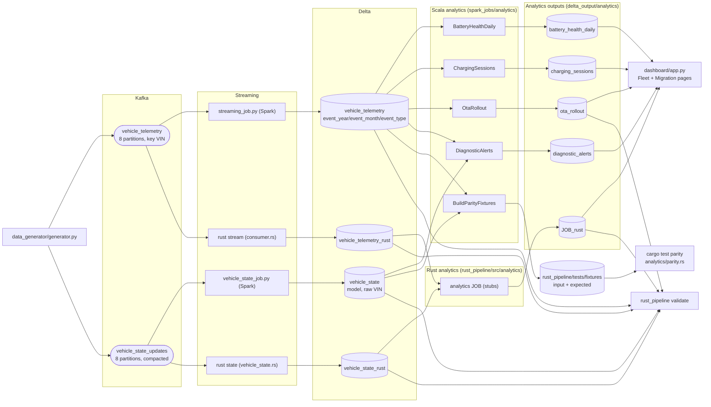

# Dependencies

`SCALA` = `spark_jobs/analytics/src/main/scala/telemetry/analytics`. Citations are `path:line`.

## Data flow

Sources: topics `config/app_config.yaml:8-11`, `docker-compose.yml:65-81`; streaming reads/writes `spark_jobs/streaming_job.py:187-192,241-247`, `spark_jobs/vehicle_state_job.py:120-172`, `rust_pipeline/src/consumer.rs:26-60,115`, `rust_pipeline/src/vehicle_state.rs:61,124`; Delta paths `config/app_config.yaml:36-84`; analytics inputs `SCALA/BatteryHealthDaily.scala:43-44`, `SCALA/ChargingSessions.scala:40-41`, `SCALA/OtaRollout.scala:46-47`, `SCALA/DiagnosticAlerts.scala:36-40`; fixtures `SCALA/BuildParityFixtures.scala:19-65`, `rust_pipeline/src/analytics/parity.rs:22-58`; Rust analytics `rust_pipeline/src/analytics/mod.rs:82-111`; dashboard `dashboard/app.py:212-225,650-748`; validate `rust_pipeline/src/validate.rs:35-50,60-85`, `rust_pipeline/src/main.rs:43-55` (the `ota_rollout` edges into `validate` stand for any `validate --job <job>`).

## What each analytics job reads, writes and shares

| Job | Reads (data) | Writes | Shares — code | Shares — data |
|-----|--------------|--------|---------------|---------------|
| `battery_health_daily` | `vehicle_telemetry`, `event_type = 'BATTERY'` (`SCALA/BatteryHealthDaily.scala:16,43-44`) | `analytics/battery_health_daily`, partitioned by `event_date` (`SCALA/BatteryHealthDaily.scala:10`) | Scala: `AnalyticsJob` trait / `Cli` / `Config` / `Paths` / `Spark` (`SCALA/AnalyticsJob.scala`), registered in `SCALA/BuildParityFixtures.scala:19-24`, one JAR (`spark_jobs/analytics/build.sbt`). Rust: `JOBS`, dispatcher, `run`, `write_output` (`rust_pipeline/src/analytics/mod.rs:28-111`), `rust_pipeline/src/analytics/parity.rs`, `rust_pipeline/src/validate.rs`. Dashboard registry (`dashboard/app.py:178-207`). | telemetry with all other jobs; output read only by the dashboard (`dashboard/app.py:662-691`) |
| `charging_sessions` | `vehicle_telemetry`, `event_type = 'CHARGING'` and non-null `charge_session_id` (`SCALA/ChargingSessions.scala:13,40-41`) | `analytics/charging_sessions`, partitioned by `session_date` (`SCALA/ChargingSessions.scala:9`) | same shared code; also parses `event_time` with `to_timestamp` exactly as `diagnostic_alerts` does (`SCALA/ChargingSessions.scala:16-17`, `SCALA/DiagnosticAlerts.scala:26-27`) | telemetry; output read only by the dashboard (`dashboard/app.py:693-712`) |
| `ota_rollout` | `vehicle_telemetry`, `event_type = 'OTA'` (`SCALA/OtaRollout.scala:32,46-47`) | `analytics/ota_rollout`, unpartitioned (`SCALA/AnalyticsJob.scala:77`) | same shared code; no helper beyond `round` | telemetry; output read only by the dashboard (`dashboard/app.py:714-730`) |
| `diagnostic_alerts` | `vehicle_telemetry`, `event_type = 'DIAGNOSTIC'`, **plus `vehicle_state`** (`SCALA/DiagnosticAlerts.scala:13-20,36-40`) | `analytics/diagnostic_alerts`, unpartitioned (`SCALA/AnalyticsJob.scala:77`) | same shared code; `to_timestamp(event_time)` as `charging_sessions`; `sha2(vin, 256)` as the telemetry stream's anonymisation (`spark_jobs/transforms.py:173`) and the fixture builder (`SCALA/BuildParityFixtures.scala:41`) | telemetry + vehicle_state (the only job that needs the state stream); output read only by the dashboard (`dashboard/app.py:732-748`) |

Every job uses Spark `round` (`SCALA/BatteryHealthDaily.scala:20,23,39`, `SCALA/ChargingSessions.scala:19,28,35`, `SCALA/OtaRollout.scala:24`, `SCALA/DiagnosticAlerts.scala:32`). The Rust side has a Spark-compatible **scalar** `spark_round(f64, u32)` used by the streaming transforms (`rust_pipeline/src/transforms/rounding.rs:1-28`, `rust_pipeline/src/transforms/location_features.rs:1,12-13`), but no DataFusion UDF that the analytics jobs, which build DataFusion plans (`rust_pipeline/src/analytics/mod.rs:70-78`), could call; DataFusion's built-in `round` does not go through that helper.

No analytics job reads another analytics job's output: each `summarize` takes only telemetry (and, for diagnostics, vehicle_state) (`SCALA/BuildParityFixtures.scala:19-24`), and outputs are consumed only by the dashboard and `validate` (`dashboard/app.py:212-225`, `rust_pipeline/src/validate.rs:60-85`).

## What can move independently, and what has to move first

**Independent:** all four jobs. There is no job-to-job data edge (table above), the Rust registry and dispatcher already list all four (`rust_pipeline/src/analytics/mod.rs:49-54,70-78`), and each job's parity test lives in its own module (`rust_pipeline/src/analytics/ota_rollout.rs:21-22`). Porting one job changes only `<job>_rust`, which nothing but the dashboard and `validate` reads (`rust_pipeline/src/config.rs:224-232`, `dashboard/app.py:223`).

**Has to move first:**
1. **Upstream Rust streams.** Rust analytics read `vehicle_telemetry_rust` and `vehicle_state_rust`, never the Spark tables (`rust_pipeline/src/analytics/mod.rs:84-87`). Both streams already exist and have their own parity checks (`rust_pipeline/src/validate.rs:35-50`). `run` opens `vehicle_state_rust` for **every** job, so even telemetry-only jobs need that table to exist in production (`rust_pipeline/src/analytics/mod.rs:86-87`).
2. **A Spark-compatible `round` usable from DataFusion**, because all four jobs use it. Spark rounds HALF_UP on the decimal value: `round(cast(1.005 as double), 2)` returns `1.01` on Spark 3.5.1 (verified in a local `pyspark==3.5.1` session; same example in `rust_pipeline/src/transforms/rounding.rs:3-6,36`), while naive `f64` rounding gives `1.0`. The scalar helper exists (`rust_pipeline/src/transforms/rounding.rs:7`); what is missing is a shared wrapper (for example a `ScalarUDF`) that analytics plans can call. Without it, every job file would have to wrap `spark_round` itself.
3. **A Spark-compatible `to_timestamp(event_time)`** before `charging_sessions` or `diagnostic_alerts` (`SCALA/ChargingSessions.scala:16-17`, `SCALA/DiagnosticAlerts.scala:26-27`). Not needed by `ota_rollout` or `battery_health_daily`.
4. **`vehicle_state_rust` parity** before `diagnostic_alerts`, because its `battery_pack_type` and fleet-size denominator come from that table (`SCALA/DiagnosticAlerts.scala:13-14`).

**Has to move last:** retiring Scala. `BuildParityFixtures` calls all four Scala `summarize` functions to produce the Rust tests' expected outputs (`SCALA/BuildParityFixtures.scala:19-24`, `rust_pipeline/src/analytics/parity.rs:37-58`), CI builds the JAR (`.github/workflows/ci.yml:55-65`), and the dashboard launches the Scala classes (`dashboard/app.py:275-284`). None of those can be removed until every job is ported.

Migration slices built on this map are in `migration-slices.md`.
