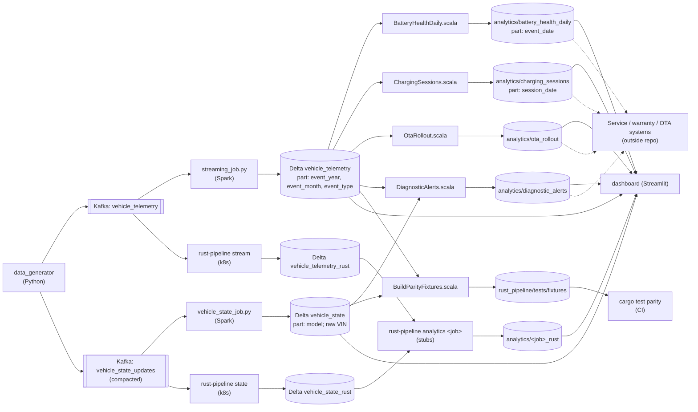

# Legacy pipeline dependencies

Citations are `path:line` relative to the repo root. Job details: [inventory.md](inventory.md);
calculations: [jobs/](jobs/). Migration slices: [migration-slices.md](migration-slices.md).

## Data flow

Sources: producer topics `data_generator/generator.py:272-273`; Spark streams
`spark_jobs/streaming_job.py:187-247`, `spark_jobs/vehicle_state_job.py:120-172`; Rust streams
`rust_pipeline/src/consumer.rs:25-115`, `rust_pipeline/src/vehicle_state.rs:1-45`,
`deploy/k8s/telemetry-stream.yaml:36`, `deploy/k8s/vehicle-state-stream.yaml:36`; analytics inputs
`spark_jobs/analytics/src/main/scala/telemetry/analytics/AnalyticsJob.scala:45-53`; fixtures
`spark_jobs/analytics/src/main/scala/telemetry/analytics/BuildParityFixtures.scala:19-61`; Rust analytics
`rust_pipeline/src/analytics/mod.rs:82-110`; dashboard `dashboard/app.py:137-147`, `dashboard/app.py:662-760`;
external consumers `README.md:6` (dashed: not in repo).

## What each analytics job reads, writes and shares

| Job | Reads | Writes | Shares — code | Shares — data |
|---|---|---|---|---|
| `battery_health_daily` | `vehicle_telemetry` BATTERY rows: 9 columns incl. stream-derived `event_date`, `cell_temp_spread`, `thermal_alert` (`spark_jobs/analytics/src/main/scala/telemetry/analytics/BatteryHealthDaily.scala:16-26`) | `analytics/battery_health_daily`, part. `event_date` | `AnalyticsJob` trait/`Paths`/`Spark` (`AnalyticsJob.scala:45-91`); `BuildParityFixtures.Jobs` (`BuildParityFixtures.scala:19-24`); one jar (`spark_jobs/analytics/build.sbt`). Rust: `analytics/mod.rs` registry, `parity.rs`, `validate.rs`, `spark_round` (`rust_pipeline/src/transforms/rounding.rs`) | Telemetry table and shared fixture input; T3/T4 column semantics from `spark_jobs/transforms.py:99-157`; dashboard reads 7 output columns (`dashboard/app.py:662-692`) |
| `charging_sessions` | `vehicle_telemetry` CHARGING rows with session id: 10 columns incl. `is_fault` (`spark_jobs/analytics/src/main/scala/telemetry/analytics/ChargingSessions.scala:13-24`) | `analytics/charging_sessions`, part. `session_date` | Same as above | Telemetry table, fixture input; T4 `is_fault` / `FAULT_CHARGE_STATES` (`spark_jobs/transforms.py:24-31`, `:127-157`); dashboard reads `energy_added_kwh`, `had_fault`, `duration_minutes`, `end_state`, `session_date`, `model_safe` (`dashboard/app.py:693-713`) |
| `ota_rollout` | `vehicle_telemetry` OTA rows: 5 columns (`spark_jobs/analytics/src/main/scala/telemetry/analytics/OtaRollout.scala:26-43`) | `analytics/ota_rollout`, unpartitioned | Same as above. Its update-state lists are private to the object (`OtaRollout.scala:11-21`); the stream has its own copy of the failed list (`spark_jobs/transforms.py:33-37`) | Telemetry table, fixture input; T1 `model_safe` only (`spark_jobs/transforms.py:69-80`); dashboard reads all state columns, `vehicles` and both rates (`dashboard/app.py:714-731`) |
| `diagnostic_alerts` | `vehicle_telemetry` DIAGNOSTIC rows **and** `vehicle_state` (`vin`, `battery_pack_type`, row count) (`spark_jobs/analytics/src/main/scala/telemetry/analytics/DiagnosticAlerts.scala:13-28`) | `analytics/diagnostic_alerts`, unpartitioned | Same as above, plus SHA-256 of VIN must match T6 (`spark_jobs/transforms.py:169-177`, `rust_pipeline/src/transforms/anonymized.rs:8-9`) | Both tables and both fixture inputs; dashboard reads its output (`dashboard/app.py:732-760`) |

Observations:

- **No analytics job reads another analytics job's output.** Each `build` reads only `paths.telemetry`
  and (for diagnostics) `paths.vehicleState` (`AnalyticsJob.scala:49-50`; `build` methods in each job file).
- **Shared Scala code is infrastructure only** (config, session, writer). No job calls another's `summarize`
  except `BuildParityFixtures`, which calls all four (`BuildParityFixtures.scala:19-24`).
- **Rust registry is already complete.** All four modules, `JOBS`, and dispatch exist, and "porting a job only
  touches that job's file" (`rust_pipeline/src/analytics/mod.rs:1-15`, `:49-54`).
- **Fixtures are shared input, per-job expected output** (`rust_pipeline/src/analytics/parity.rs:22-45`).
  Regenerating them rewrites every job's expected output (`BuildParityFixtures.scala:59-61`).
- **Output tables are contracts.** The dashboard reads named columns, and README names external consumers
  (`README.md:6`); the parity check enforces exact names and types (`rust_pipeline/src/validate.rs:185-212`).

## Independence and ordering

| Job | Can migrate independently? | Must move / exist first |
|---|---|---|
| `ota_rollout` | Yes | Rust telemetry stream (done, `README.md:55-61`) |
| `charging_sessions` | Yes | Rust telemetry stream (done) |
| `battery_health_daily` | Yes | Rust telemetry stream (done) |
| `diagnostic_alerts` | Yes, but has the widest boundary | Rust telemetry **and** state streams (both done, `README.md:55-61`); state parity is checked separately with `validate --state` (`README.md:58-60`) |

What has to move first, in order:

1. **Upstream streams** — already ported, so every analytics port can run on `*_rust` tables
   (`rust_pipeline/src/analytics/mod.rs:82-87`).
2. **Nothing else blocks the four ports.** They can proceed in parallel; the only shared Rust code a port
   may want to add is reusable Spark-semantics helpers (`min_by`/`max_by`, timestamp parsing), which
   should land with the first job that needs them (see [migration-slices.md](migration-slices.md)).
3. **Last, not first:** `BuildParityFixtures.scala` and the shared `AnalyticsJob.scala` must stay until every
   job is ported, because fixtures are regenerated by running all four Scala jobs
   (`BuildParityFixtures.scala:19-61`), and CI builds the jar (`.github/workflows/ci.yml:55-65`).
4. **Production cutover** has no existing deployment to replace: neither Spark nor Rust analytics is scheduled
   in the repo (`deploy/k8s/kustomization.yaml:9-13`; `README.md:67-93`). Consumers switch from `<job>` to
   `<job>_rust` paths (`rust_pipeline/src/config.rs:225-232`) per job, after parity.
