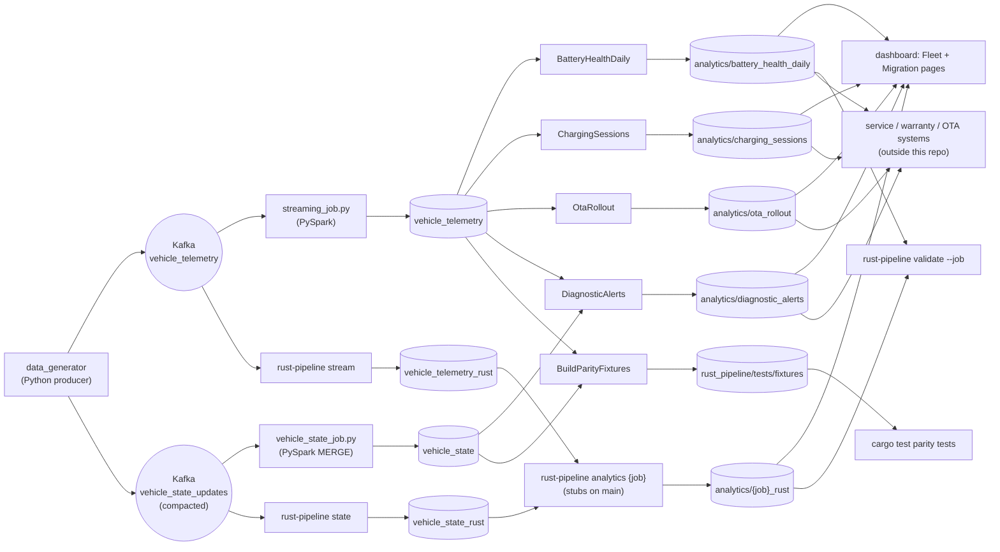

# Dependencies

How data moves from Kafka to the consumers, and what each analytics job reads,
writes and shares with the others, both code and data. Citations are
`path:line`. Job names refer to [inventory.md](inventory.md). Scala paths
are shortened to the file name and live under
`spark_jobs/analytics/src/main/scala/telemetry/analytics/`.

## Data flow

Evidence for each edge:

| Edge | Evidence |
|---|---|
| generator → both topics, keyed by VIN | `data_generator/generator.py:272-273` |
| `vehicle_telemetry` → Spark / Rust stream | `spark_jobs/streaming_job.py:190`, `rust_pipeline/src/main.rs:33-34`, `README.md:42-43` |
| `vehicle_state_updates` → Spark / Rust state | `spark_jobs/vehicle_state_job.py:164`, `rust_pipeline/src/main.rs:35-36`, `README.md:45-47` |
| streams → Delta tables | `spark_jobs/streaming_job.py:241-246`, `spark_jobs/vehicle_state_job.py:120-143`, `config/app_config.yaml:36`, `:56`, `:77`, `:81` |
| Spark tables → Scala jobs | `BatteryHealthDaily.scala:43-44`, `ChargingSessions.scala:40-41`, `OtaRollout.scala:46-47`, `DiagnosticAlerts.scala:36-40`, paths in `AnalyticsJob.scala:49-50` |
| Scala jobs → `analytics/<job>` | `AnalyticsJob.scala:86-91`, `config/app_config.yaml:61` |
| Rust tables → Rust analytics → `<job>_rust` | `rust_pipeline/src/analytics/mod.rs:82-94`, `rust_pipeline/src/config.rs:229-232` |
| Spark tables → fixtures → parity tests | `BuildParityFixtures.scala:34-63`, `rust_pipeline/src/analytics/parity.rs:22-58` |
| analytics tables → dashboard | Fleet page reads `<job>` or `<job>_rust` (`dashboard/app.py:216-224`, `:637-760`). Migration page counts rows and shows reports (`dashboard/app.py:477-487`) |
| analytics tables → `validate --job` | `rust_pipeline/src/main.rs:89-92` |
| analytics tables → external systems | `README.md:5-7`. No consumer code for these is in the repo |

Demo data bypasses Kafka: `scripts/load_demo_data.py:53-69` writes the
fixture input into all four stream tables and Spark's expected output into
`analytics/<job>`.

## What each analytics job reads, writes and shares

| Job | Reads (table: columns) | Writes | Shared code | Shared data |
|---|---|---|---|---|
| `ota_rollout` | `vehicle_telemetry`: `event_type`, `vin_hash`, `target_software_version`, `sequence_number`, `model_safe`, `update_state` (`OtaRollout.scala:27-43`) | `analytics/ota_rollout`, no partitions | Scala: `AnalyticsJob.scala`, listed in `BuildParityFixtures.scala:22`. Rust: `analytics/mod.rs`, `parity.rs`, `validate.rs`, `transforms/rounding.rs` | `vehicle_telemetry` (with all jobs). Depends on enrichment columns `vin_hash` (T6), `model_safe` (T1) |
| `battery_health_daily` | `vehicle_telemetry`: `event_type`, `vin_hash`, `event_date`, `model_safe`, `charge_percent`, `max_cell_temp`, `cell_temp_spread`, `thermal_alert`, `battery_health_level`, `sequence_number` (`BatteryHealthDaily.scala:15-40`) | `analytics/battery_health_daily`, partitioned `event_date` | same as above (`BuildParityFixtures.scala:20`) | `vehicle_telemetry`. Depends on `event_date` (T2), `cell_temp_spread` (T3), `thermal_alert` (T4) |
| `charging_sessions` | `vehicle_telemetry`: `event_type`, `charge_session_id`, `vin_hash`, `model_safe`, `event_time`, `energy_added_kwh`, `charging_power_kw`, `charge_percent`, `sequence_number`, `charge_state`, `is_fault` (`ChargingSessions.scala:12-37`) | `analytics/charging_sessions`, partitioned `session_date` | same as above (`BuildParityFixtures.scala:21`) | `vehicle_telemetry`. Depends on `is_fault` (T4) |
| `diagnostic_alerts` | `vehicle_telemetry`: `event_type`, `vin_hash`, `dtc_code`, `ecu`, `model_safe`, `warning_state`, `event_time` (`battery_pack_type` dropped). `vehicle_state`: `vin`, `battery_pack_type`, row count (`DiagnosticAlerts.scala:11-33`) | `analytics/diagnostic_alerts`, no partitions | same as above (`BuildParityFixtures.scala:23`), plus SHA-256 hex (Rust has `transforms/anonymized.rs:20`) | the only job that reads `vehicle_state` (`rust_pipeline/src/analytics/mod.rs:86-87`) |

The T1-T7 enrichment columns are defined in `spark_jobs/transforms.py:69-187`
and mirrored in `rust_pipeline/src/transforms/`.

### Shared code in detail

- **`AnalyticsJob.scala`** (all four Scala jobs): CLI parsing, config,
  table paths, Spark session (UTC, shuffle partitions) and the overwrite
  writer (`AnalyticsJob.scala:9-97`). No job calls another job's code. The
  only cross-job references are in `BuildParityFixtures.scala:19-24`, which
  calls every job's `summarize`.
- **`rust_pipeline/src/analytics/mod.rs`** (all four Rust ports): the `Job`
  registry, dispatcher and Delta writer already list every job, so a port
  only edits its own file (`rust_pipeline/src/analytics/mod.rs:9-10`,
  `:49-54`, `:70-78`, `:98-111`).
- **`rust_pipeline/src/analytics/parity.rs`** and
  **`rust_pipeline/src/validate.rs`**: the parity test and comparison rules
  (keys, doubles within 1e-9, exact column names and types, no PII columns)
  (`rust_pipeline/src/validate.rs:19-23`, `:85-153`, `:183-212`).
- **`rust_pipeline/src/transforms/rounding.rs`**: `spark_round`, Spark's
  HALF_UP rounding on the decimal form of a double
  (`rust_pipeline/src/transforms/rounding.rs:1-28`). All four jobs call
  `round`. On `main` this is a plain Rust function, not a DataFusion UDF,
  so a DataFusion-based port cannot call it yet. Open
  [PR #20](https://github.com/ajaj3030/vehicle-telemetry-spark-to-rust/pull/20)
  adds `spark_round_udf()` and an `event_time` string-to-timestamp helper.
- **Duplicated constants:** the failed OTA states in `OtaRollout.scala:21`
  are the same list as `FAILED_UPDATE_STATES` in `spark_jobs/transforms.py:33-37`,
  which feeds `is_fault` and so `charging_sessions.had_fault`. Nothing ties
  the two lists together in code.

### Shared data in detail

- All four jobs read the same `vehicle_telemetry` table. Each filters a
  different `event_type`, so no two jobs read the same rows.
- Only `diagnostic_alerts` reads `vehicle_state`.
- **No analytics job reads another analytics job's output.** Each writes its
  own table under `analytics.output_base`, and the Rust ports write separate
  `<job>_rust` tables (`rust_pipeline/src/config.rs:224-232`), so a port can
  run next to its Spark job without touching Spark's output.
- Downstream readers depend on exact column names and types
  (`rust_pipeline/src/validate.rs:183-185`). The dashboard selects some
  columns by name or prefix, for example `UPDATE_*` in
  `dashboard/app.py:715`.

## What can move independently, and what has to move first

**Independent:** all four analytics jobs. There is no data edge between
them, the Rust registry already lists all four, each port writes its own
`<job>_rust` table, and each has its own fixture and parity test (see the
two sections above). Any order works, and two jobs can be ported in parallel.

**Has to be in place first:**

1. **The Rust streams (already done).** Rust analytics read
   `vehicle_telemetry_rust` and `vehicle_state_rust`, not the Spark tables
   (`rust_pipeline/src/analytics/mod.rs:84-87`), so live runs depend on the
   stream ports. Those are ported and validated (`README.md:59-60`).
2. **Spark-semantics helpers that DataFusion lacks.** These are needed by
   whichever port uses them first:
   - Spark `round` (all four jobs): DataFusion's `round(1.005, 2)` gives
     1.0, Spark gives 1.01 (see [ota_rollout.md](jobs/ota_rollout.md#hardest-spark-behaviour-to-reproduce)).
     `spark_round` exists but is not callable from DataFusion on `main`.
   - `to_timestamp(event_time)` with Spark's parsing and a µs UTC result
     (`charging_sessions`, `diagnostic_alerts`).
   - SHA-256 as a lowercase hex string (`diagnostic_alerts`).

   PR #20 covers the first two. If it does not merge first, the first port
   has to add the rounding UDF itself.
3. **`vehicle_state_rust` parity** before `diagnostic_alerts` goes live:
   that is its second input. `validate --state` checks it (`README.md:60`).
4. **Keep the Scala harness until the last job is ported.**
   `BuildParityFixtures` regenerates the expected output for all four jobs at
   once (`BuildParityFixtures.scala:19-24`, `:59-63`). Delete the Scala jobs
   only after every port passes.
