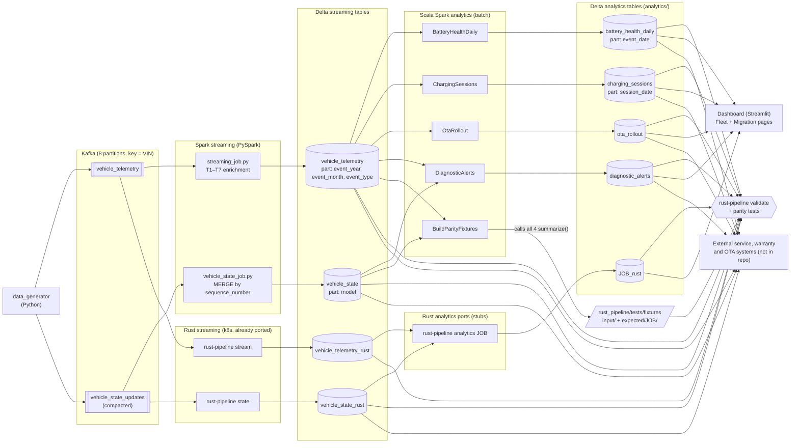

# Legacy pipeline dependencies

How data and code flow between the jobs in [inventory.md](inventory.md).
Scala paths are shortened to `analytics/<File>.scala` =
`spark_jobs/analytics/src/main/scala/telemetry/analytics/<File>.scala`.

## Data flow: Kafka to consumers

Sources for each edge:

| Edge | Source |
|------|--------|
| generator → topics | `data_generator/generator.py:272-274` |
| topics → Spark streams | `spark_jobs/streaming_job.py:186-195`, `spark_jobs/vehicle_state_job.py:160-172` |
| topics → Rust streams | `rust_pipeline/src/consumer.rs:25-60`, `rust_pipeline/src/vehicle_state.rs:60-80` |
| streams → Delta tables + partitions | `spark_jobs/streaming_job.py:240-247`, `spark_jobs/vehicle_state_job.py:125`, `rust_pipeline/src/consumer.rs:33-37`, `rust_pipeline/src/vehicle_state.rs:124` |
| Delta → Scala analytics | `analytics/BatteryHealthDaily.scala:43-44`, `analytics/ChargingSessions.scala:40-41`, `analytics/OtaRollout.scala:46-47`, `analytics/DiagnosticAlerts.scala:36-40` |
| Scala analytics → analytics tables | `analytics/AnalyticsJob.scala:86-91` |
| BuildParityFixtures | `analytics/BuildParityFixtures.scala:19-24`, `analytics/BuildParityFixtures.scala:34-63` |
| Rust streaming tables → Rust analytics → `<job>_rust` | `rust_pipeline/src/analytics/mod.rs:82-95`, `rust_pipeline/src/config.rs:230-232` |
| validate / parity tests | `rust_pipeline/src/main.rs:80-114`, `rust_pipeline/src/analytics/parity.rs:37-58` |
| analytics tables → dashboard | `dashboard/app.py:212-225`, `dashboard/app.py:644-760` |
| tables → external systems | `README.md:5-7`, `spark_jobs/vehicle_state_job.py:4-6` |
| fixtures → demo loader → every table above (left out of the diagram for readability) | `scripts/load_demo_data.py:53-74` |

## What each analytics job reads, writes and shares

| Job | Reads (data) | Writes (data) | Reads another analytics job's output? | Shared code it depends on | Data it shares with other jobs |
|-----|--------------|---------------|----------------------------------------|---------------------------|-------------------------------|
| `battery_health_daily` | `vehicle_telemetry` (BATTERY) `analytics/BatteryHealthDaily.scala:16`, `:43-44` | `analytics/battery_health_daily`, part. `event_date` | no | Scala: `AnalyticsJob` trait, `Paths`, `Spark.session` (`analytics/AnalyticsJob.scala:45-97`); called by `BuildParityFixtures` (`analytics/BuildParityFixtures.scala:20`). Rust: `Job`, `JOBS`, dispatcher, `run`, `write_output` (`rust_pipeline/src/analytics/mod.rs:28-111`), `rust_pipeline/src/analytics/parity.rs`, `rust_pipeline/src/validate.rs`. | telemetry table and `fixtures/input/telemetry` with all four jobs |
| `charging_sessions` | `vehicle_telemetry` (CHARGING) `analytics/ChargingSessions.scala:13`, `:40-41` | `analytics/charging_sessions`, part. `session_date` | no | same as above; `analytics/BuildParityFixtures.scala:21` | same |
| `ota_rollout` | `vehicle_telemetry` (OTA) `analytics/OtaRollout.scala:32`, `:46-47` | `analytics/ota_rollout` | no | same as above; `analytics/BuildParityFixtures.scala:22` | same |
| `diagnostic_alerts` | `vehicle_telemetry` (DIAGNOSTIC) **and** `vehicle_state` `analytics/DiagnosticAlerts.scala:12-20`, `:36-40` | `analytics/diagnostic_alerts` | no | same as above; `analytics/BuildParityFixtures.scala:23`, the only entry that uses the state input | also the only job reading `vehicle_state` / `fixtures/input/vehicle_state` |

Code shared by all four jobs outside the job files, and therefore touched by
cutover rather than by a port:

| Shared piece | Where | Couples |
|--------------|-------|---------|
| Scala runtime (CLI, config, paths, session, overwrite write) | `analytics/AnalyticsJob.scala:9-97` | all 4 Scala jobs and `BuildParityFixtures` |
| One jar for all jobs | `spark_jobs/analytics/build.sbt:7-18`, `dashboard/app.py:245-246` | all 4 |
| Fixture builder calling every `summarize` | `analytics/BuildParityFixtures.scala:19-24` | all 4; expected outputs come from one shared input slice |
| Rust registry + dispatcher + writer (already lists every job) | `rust_pipeline/src/analytics/mod.rs:12-15`, `:49-54`, `:70-78`, `:98-111` | all 4; "Porting a job only touches that job's file" (`rust_pipeline/src/analytics/mod.rs:9-10`) |
| Partition test pinning all four jobs | `rust_pipeline/src/analytics/mod.rs:121-132` | all 4 |
| Parity harness and validator | `rust_pipeline/src/analytics/parity.rs:22-58`, `rust_pipeline/src/validate.rs:85-153` | all 4 |
| Spark-compatible round (scalar only, used by the streaming transforms) | `rust_pipeline/src/transforms/rounding.rs:7-28`, used at `rust_pipeline/src/transforms/battery_features.rs:27-41`, `rust_pipeline/src/transforms/location_features.rs:12-13` | none of the analytics jobs yet |
| Dashboard registries | `dashboard/app.py:178-207`, `dashboard/app.py:275-284`, `dashboard/app.py:461-468` | all 4 |
| Partitioning duplicated in the demo loader | `scripts/load_demo_data.py:35-40` | all 4 |

### Spark behaviours each job needs in Rust

Shared helpers that do not exist yet in `rust_pipeline/src/analytics/` (the
module has only the four stubs, `rust_pipeline/src/analytics/mod.rs` and
`rust_pipeline/src/analytics/parity.rs`). Details are in each
job's spec under `jobs/`.

| Spark behaviour | battery | charging | ota | diag |
|-----------------|:-:|:-:|:-:|:-:|
| `round` HALF_UP inside a query | ✓ | ✓ | ✓ | ✓ |
| `bigint / bigint` → double, `x / 0` → null | | | ✓ | ✓ |
| `max_by` / `min_by` (null value at the extreme is kept) | ✓ | ✓ | | |
| `to_timestamp(string)` → µs UTC timestamp | | ✓ | | ✓ |
| Timestamp → epoch seconds (double), `to_date` | | ✓ | | |
| `row_number` latest-per-key | | | ✓ | |
| `pivot` over a fixed value list + `na.fill(0)` | | | ✓ | |
| Range window over calendar days | ✓ | | | |
| `lag` row offset (not calendar) | ✓ | | | |
| `dense_rank` as 32-bit int | | | | ✓ |
| `sha2(…, 256)` hex join key | | | | ✓ |
| Left join with a second table + eager row count | | | | ✓ |
| Partitioned Delta write | ✓ | ✓ | | |
| **Count** | 5 | 5 | 4 | 6 |

## Which jobs can migrate independently, and what must move first

**Independent.** No analytics job reads another analytics job's output: each
`build` reads only the streaming tables (`analytics/BatteryHealthDaily.scala:43-44`,
`analytics/ChargingSessions.scala:40-41`, `analytics/OtaRollout.scala:46-47`,
`analytics/DiagnosticAlerts.scala:36-40`). The Rust registry and dispatcher
already list every job (`rust_pipeline/src/analytics/mod.rs:49-54`, `:70-78`),
and each port writes its own `<job>_rust` table (`rust_pipeline/src/config.rs:230-232`),
so all four ports can land in any order without changing another job's data.

**Must move first:**

1. **The streaming ports, done.** Rust analytics read `vehicle_telemetry_rust`
   and `vehicle_state_rust` (`rust_pipeline/src/analytics/mod.rs:84-87`), so
   their parity (`validate --state`, `rust_pipeline/src/main.rs:97-113`) is an
   upstream condition of every live Rust analytics result. `diagnostic_alerts`
   is the only job that also needs `vehicle_state_rust`.
2. **A Spark HALF_UP `round` usable in DataFusion.** All four jobs need it
   (table above); only the scalar `spark_round` exists
   (`rust_pipeline/src/transforms/rounding.rs:7-28`). Whichever slice goes
   first has to add it, ideally as a shared analytics helper so later slices
   reuse it rather than copy it.
3. **`max_by`/`min_by` and string-timestamp helpers** are each shared by two
   jobs (battery + charging; charging + diag). The first of each pair adds them.

**Must move last:** retiring Scala. `BuildParityFixtures` calls all four
`summarize` functions (`analytics/BuildParityFixtures.scala:19-24`) and is the
only way to regenerate expected outputs (`README.md:124-136`), so the Scala
jar must stay until every job is cut over or the fixtures are frozen. CI's sbt
job (`.github/workflows/ci.yml:50-65`) and the dashboard's Spark job registry
(`dashboard/app.py:275-284`) go with it.

## Cross-cutting risks found while mapping

- `rust-pipeline analytics <job>` opens `vehicle_state_rust` for every job
  (`rust_pipeline/src/analytics/mod.rs:86-87`), so even a telemetry-only port
  fails at runtime if that table is missing.
- No scheduler exists for either engine's analytics jobs: Spark runs on demand
  (`README.md:86-91`, `dashboard/app.py:275-284`) and Kubernetes only deploys
  the two streams (`deploy/k8s/kustomization.yaml:9-13`). Production cadence is
  not recorded in the repo.
- The external consumers (`README.md:5-7`) are not in the repo; the type
  contract in `rust_pipeline/src/validate.rs:183-203` is the only record of
  what they rely on.
- The demo loader writes Delta with an unpinned Python `deltalake`
  (`dashboard/requirements.txt:3`) while Rust pins `deltalake` 0.22
  (`rust_pipeline/Cargo.toml:13`). A reader failure on demo data from this
  mismatch was fixed on the `demo-prepared` branch by
  [PR #13](https://github.com/ajaj3030/vehicle-telemetry-spark-to-rust/pull/13),
  which is not on `main`. Parity tests read the fixtures as plain Parquet
  (`rust_pipeline/src/analytics/parity.rs:22-33`) and are not affected; the
  dashboard's "Run Rust & validate" on demo data may be.
- `README.md:78` lists the `ota_rollout` key as `model`; the column is
  `model_safe` (`analytics/OtaRollout.scala:37`).
