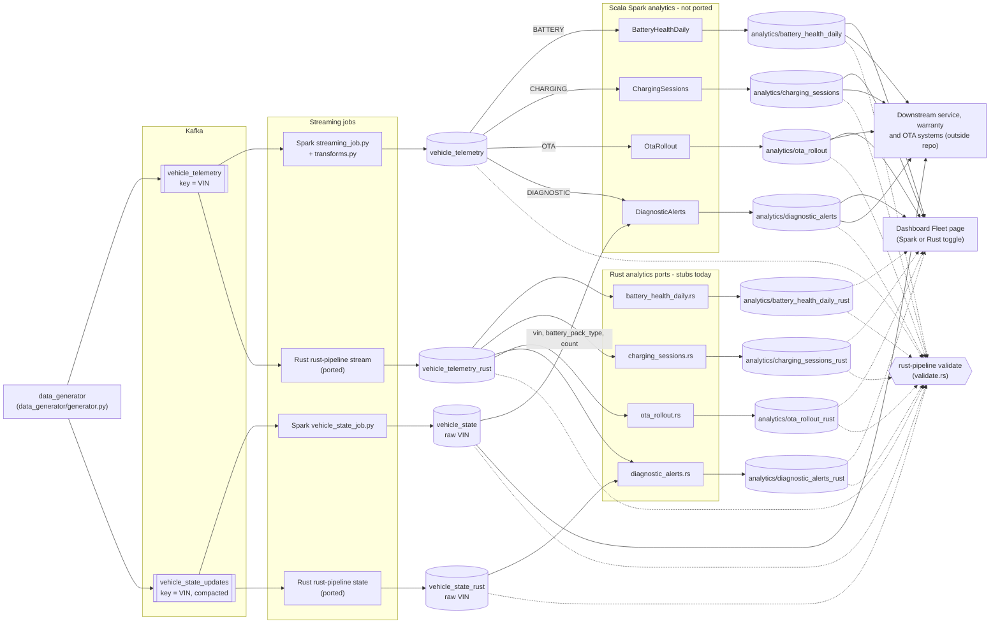

# Legacy pipeline dependencies

How data and code flow between the jobs in [inventory.md](inventory.md). Paths are relative to the repo
root; `file:N` is a line reference.

## Data flow: Kafka topics to consumers

Sources for each edge: producer → topics `data_generator/generator.py:272-274`; topic → Spark streams
`spark_jobs/streaming_job.py:190`, `spark_jobs/vehicle_state_job.py:164`; topic → Rust streams
`rust_pipeline/src/consumer.rs:40-60`, `rust_pipeline/src/vehicle_state.rs:76-77`; stream → table
`config/app_config.yaml:36,56,77,81`; table → Scala analytics `spark_jobs/analytics/src/main/scala/telemetry/analytics/AnalyticsJob.scala:44-53` and each job's
`build` (`spark_jobs/analytics/src/main/scala/telemetry/analytics/BatteryHealthDaily.scala:43-44`, `spark_jobs/analytics/src/main/scala/telemetry/analytics/ChargingSessions.scala:40-41`, `spark_jobs/analytics/src/main/scala/telemetry/analytics/OtaRollout.scala:46-47`,
`spark_jobs/analytics/src/main/scala/telemetry/analytics/DiagnosticAlerts.scala:36-40`); event-type filters `spark_jobs/analytics/src/main/scala/telemetry/analytics/BatteryHealthDaily.scala:16`, `spark_jobs/analytics/src/main/scala/telemetry/analytics/ChargingSessions.scala:13`,
`spark_jobs/analytics/src/main/scala/telemetry/analytics/OtaRollout.scala:32`, `spark_jobs/analytics/src/main/scala/telemetry/analytics/DiagnosticAlerts.scala:17`; Rust analytics read the `_rust` tables and write
`<job>_rust` (`rust_pipeline/src/analytics/mod.rs:82-95`, `rust_pipeline/src/config.rs:224-232`); dashboard
`dashboard/app.py:209-226`, `dashboard/app.py:644-656`; external readers `README.md:4-7`,
`spark_jobs/vehicle_state_job.py:4-6`; validation `rust_pipeline/src/main.rs:77-114`.

Key observation: **no analytics job reads another analytics job's output.** All four are leaves that hang
off the telemetry table; only diagnostic_alerts also reads vehicle_state.

## What each analytics job reads, writes and shares

| Job | Reads (table: rows → columns) | Writes | Shares **data** with | Shares **code** with |
|---|---|---|---|---|
| battery_health_daily | telemetry: BATTERY → vin_hash, event_date, model_safe, charge_percent, max_cell_temp, cell_temp_spread, thermal_alert, battery_health_level, sequence_number (`spark_jobs/analytics/src/main/scala/telemetry/analytics/BatteryHealthDaily.scala:15-40`) | `analytics/battery_health_daily`, partitioned by event_date (`spark_jobs/analytics/src/main/scala/telemetry/analytics/BatteryHealthDaily.scala:9-10`) | telemetry table (all jobs); fixture `input/telemetry` (all jobs) | A, B, C, D, E, F, G below |
| charging_sessions | telemetry: CHARGING with session id → charge_session_id, vin_hash, model_safe, event_time, energy_added_kwh, charging_power_kw, charge_percent, charge_state, sequence_number, is_fault (`spark_jobs/analytics/src/main/scala/telemetry/analytics/ChargingSessions.scala:12-37`) | `analytics/charging_sessions`, partitioned by session_date (`spark_jobs/analytics/src/main/scala/telemetry/analytics/ChargingSessions.scala:8-9`) | telemetry table; fixture `input/telemetry` | A–G |
| ota_rollout | telemetry: OTA → vin_hash, target_software_version, sequence_number, model_safe, update_state (`spark_jobs/analytics/src/main/scala/telemetry/analytics/OtaRollout.scala:26-44`) | `analytics/ota_rollout`, unpartitioned (`spark_jobs/analytics/src/main/scala/telemetry/analytics/OtaRollout.scala:9`) | telemetry table; fixture `input/telemetry` | A–G |
| diagnostic_alerts | telemetry: DIAGNOSTIC → vin_hash, dtc_code, ecu, model_safe, warning_state, event_time; **vehicle_state: all rows → vin, battery_pack_type, row count** (`spark_jobs/analytics/src/main/scala/telemetry/analytics/DiagnosticAlerts.scala:11-34`) | `analytics/diagnostic_alerts`, unpartitioned (`spark_jobs/analytics/src/main/scala/telemetry/analytics/DiagnosticAlerts.scala:9`) | telemetry table; **vehicle_state** (also read by service/warranty, `README.md:110-113`); fixtures `input/telemetry` **and** `input/vehicle_state` | A–G, plus H |

Shared code (every analytics job depends on all of these):

| Id | Shared artefact | What is shared | Coupling for migration |
|---|---|---|---|
| A | `spark_jobs/analytics/src/main/scala/telemetry/analytics/AnalyticsJob.scala` | `Cli`, `Config`, `Paths`, `Spark.session` (UTC), the `AnalyticsJob` trait's overwrite-Delta writer (lines 9-97) | stays until the last Scala job is gone |
| B | `spark_jobs/analytics/src/main/scala/telemetry/analytics/BuildParityFixtures.scala` | calls **all four** `summarize` functions (lines 19-24) to rebuild fixtures | deleting any Scala job breaks this file; regenerating fixture *input* changes every job's expected output |
| C | `spark_jobs/analytics/build.sbt` + CI `scala` job (`.github/workflows/ci.yml:50-65`) | one jar for all jobs | removed only after all four are ported |
| D | `rust_pipeline/src/analytics/mod.rs` | registry `JOBS`, dispatcher `summarize`, `run`, `write_output` — already list all four (lines 9-10, 49-54, 70-78) | a port does **not** need to edit it (by design, `rust_pipeline/src/analytics/mod.rs:9-10`) unless adding a shared helper module |
| E | `rust_pipeline/src/analytics/parity.rs`, `rust_pipeline/src/validate.rs` | fixture context and the parity/acceptance check (key match, exact schema, 1e-9 doubles, PII guard) | shared, stable; no per-job edits |
| F | `rust_pipeline/src/transforms/rounding.rs` | `spark_round` (HALF_UP like Spark) — used by every job's `round` | reuse; exposing it to DataFusion SQL as a UDF is a shared helper the first port should add |
| G | `dashboard/app.py:178-206` (`ANALYTICS_JOBS`), `dashboard/app.py:462-468` (`is_ported`), `scripts/load_demo_data.py:35-40` | job registry, port detection, demo loader partitions | already list all four; no per-port edits needed |
| H | `spark_jobs/transforms.py:173` / `rust_pipeline/src/transforms/anonymized.rs:20-24` | SHA-256 VIN hashing that diagnostic_alerts recomputes in-query | diagnostic_alerts' Rust port must match T6 byte for byte |

Shared *data* fixtures: `rust_pipeline/tests/fixtures/input/telemetry` (all four),
`rust_pipeline/tests/fixtures/input/vehicle_state` (diagnostic_alerts only), `rust_pipeline/tests/fixtures/expected/<job>`
(one per job) (`rust_pipeline/src/analytics/parity.rs:4-7`).

## Migration order: what is independent, what must move first

**Independent:** all four analytics jobs can be ported independently and in parallel. Evidence: no
analytics-to-analytics reads (table above); each writes its own `<job>_rust` table
(`rust_pipeline/src/config.rs:229-232`); each port is one file because the registry/dispatcher
already exist (`rust_pipeline/src/analytics/mod.rs:9-10`); each has its own parity test and expected fixture.

**Already moved (prerequisites satisfied):** the upstream tables the Rust ports read —
`vehicle_telemetry_rust` and `vehicle_state_rust` — are produced by the ported streams and gated by
`validate` / `validate --state` (`README.md:55-61`, `rust_pipeline/src/analytics/mod.rs:84-87`).

**Must move first / ordering constraints:**

1. **Shared Spark-semantics helpers before (or with) the first port.** Every job needs Spark's HALF_UP
   `round` inside DataFusion (F); three need `max_by`/`min_by` or `to_timestamp` → `timestamp[us, UTC]`. If two
   ports each invent these, they will conflict in `rust_pipeline/src/analytics/`. Land them once, in the first
   slice, as a module the others import.
2. **diagnostic_alerts after vehicle_state parity holds on live data** — it is the only job whose Rust output
   depends on `vehicle_state_rust` (`rust_pipeline/src/analytics/mod.rs:86-87`).
3. **Scala removal last.** `BuildParityFixtures` (B) needs every un-ported job's `summarize` to rebuild fixtures,
   and the jar (C) is shared, so individual Scala objects can be retired only by also editing B, and the jar,
   CI job and dashboard Spark runners (`dashboard/app.py:275-284`) only after all four are ported.
4. **Fixture input is shared.** Changing `input/telemetry` (e.g. to add OTA edge cases) needs Spark to
   regenerate **all four** expected outputs (`README.md:126-136`) — do it while Scala still exists, ideally
   before parallel ports start.
5. **A Rust batch runtime before production cutover of any job.** There is no scheduler or Kubernetes
   manifest for analytics in either engine (`deploy/k8s/kustomization.yaml:9-13`). The stream PVCs are
   `ReadWriteOnce` per processor (`deploy/k8s/storage.yaml:1-22`), so a separate batch pod cannot simply
   mount `vehicle_telemetry_rust` today; it needs shared/object storage (the manifest notes delta-rs can write
   `s3://`, `deploy/k8s/storage.yaml:1-3`). This blocks *cutover*, not porting or parity.

Proposed slices and the recommended first slice: [migration-slices.md](migration-slices.md).
