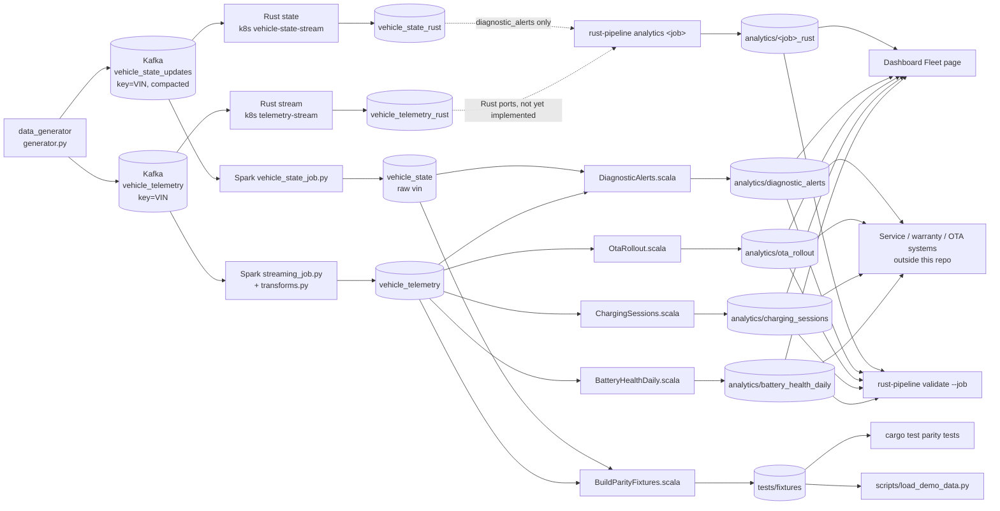

# Legacy pipeline dependencies

How data and code flow from the Kafka topics to every consumer, and what that
means for migrating the four Scala analytics jobs. Job details are in
[inventory.md](inventory.md); per-job specs are in [jobs/](jobs/).

## Data flow

Evidence for each edge:

| Edge | Evidence |
|---|---|
| generator → both topics, keyed by VIN | `data_generator/generator.py:272-274` |
| topics → Spark streams | `spark_jobs/streaming_job.py:187-191`, `spark_jobs/vehicle_state_job.py:160-165` |
| topics → Rust streams | `rust_pipeline/src/consumer.rs:25-37`, `rust_pipeline/src/vehicle_state.rs:60-77`, `deploy/k8s/telemetry-stream.yaml:36`, `deploy/k8s/vehicle-state-stream.yaml:36` |
| streams → tables | `config/app_config.yaml:36-39,56-57,77-82` |
| telemetry → every analytics job | `BatteryHealthDaily.scala:43-44`, `ChargingSessions.scala:40-41`, `OtaRollout.scala:46-47`, `DiagnosticAlerts.scala:36-40` (all under `spark_jobs/analytics/src/main/scala/telemetry/analytics/`) |
| vehicle_state → diagnostic_alerts only | `DiagnosticAlerts.scala:13-14,39` |
| Rust ports read the Rust tables | `rust_pipeline/src/analytics/mod.rs:82-87` |
| outputs → `analytics/<job>` and `<job>_rust` | `AnalyticsJob.scala:51-52,86-91`, `rust_pipeline/src/config.rs:224-232` |
| outputs → dashboard Fleet page (Spark/Rust toggle) | `dashboard/app.py:637-760` |
| outputs → `validate --job` | `rust_pipeline/src/main.rs:80-96` |
| outputs → external systems | `README.md:3-7` (named only; no code in this repo) |
| tables → fixtures → CI / demo | `BuildParityFixtures.scala:34-63`, `rust_pipeline/src/analytics/parity.rs:22-58`, `.github/workflows/ci.yml:35-36`, `scripts/load_demo_data.py:58-69` |

No analytics job reads another analytics job's output: each `build` reads
only `paths.telemetry` and (for diagnostics) `paths.vehicleState`
(`AnalyticsJob.scala:49-50`).

## What each analytics job reads, writes and shares

| Job | Reads (table: columns) | Writes | Shares data with | Shares code with |
|---|---|---|---|---|
| `battery_health_daily` | telemetry: `event_type`, `vin_hash`, `event_date`, `model_safe`, `charge_percent`, `max_cell_temp`, `cell_temp_spread`, `thermal_alert`, `battery_health_level`, `sequence_number` (`BatteryHealthDaily.scala:16-25`) | `analytics/battery_health_daily`, part. `event_date` | Input telemetry table with all jobs; output read only by Fleet tab "Battery Health" (`dashboard/app.py:662-691`) | Scala: `AnalyticsJob.scala`, `BuildParityFixtures.scala:20`. Rust: needs `max_by` (shared with charging), Spark `round` (all) |
| `charging_sessions` | telemetry: `event_type`, `charge_session_id`, `vin_hash`, `model_safe`, `event_time`, `energy_added_kwh`, `charging_power_kw`, `charge_percent`, `charge_state`, `is_fault`, `sequence_number` (`ChargingSessions.scala:13-24`) | `analytics/charging_sessions`, part. `session_date` | Telemetry with all jobs; output read by Fleet tab "Charging" (`dashboard/app.py:693-712`) | Scala: `AnalyticsJob.scala`, `BuildParityFixtures.scala:21`. Rust: needs `min_by`/`max_by` (shared with battery), string→timestamp (shared with diagnostics), Spark `round` |
| `ota_rollout` | telemetry: `event_type`, `vin_hash`, `target_software_version`, `sequence_number`, `model_safe`, `update_state` (`OtaRollout.scala:27-38`) | `analytics/ota_rollout`, unpartitioned | Telemetry with all jobs; output read by Fleet tab "OTA Rollout" (`dashboard/app.py:714-730`), which discovers the state columns by the `UPDATE_` prefix (`dashboard/app.py:715`) | Scala: `AnalyticsJob.scala`, `BuildParityFixtures.scala:22`. Rust: Spark `round` and null-on-zero division only |
| `diagnostic_alerts` | telemetry: `event_type`, `vin_hash`, `dtc_code`, `ecu`, `model_safe`, `warning_state`, `event_time` (drops `battery_pack_type`); **vehicle_state: `vin`, `battery_pack_type`, row count** (`DiagnosticAlerts.scala:13-28`) | `analytics/diagnostic_alerts`, unpartitioned | Telemetry with all jobs; **only job reading `vehicle_state`** (raw VIN); output read by Fleet tab "Diagnostics" (`dashboard/app.py:732-748`) | Scala: `AnalyticsJob.scala`, `BuildParityFixtures.scala:23`. Rust: SHA-256 hex (same as `rust_pipeline/src/transforms/anonymized.rs:20`), string→timestamp (shared with charging), Spark `round`, null-on-zero division |

### Shared code, both sides

Scala (stays until the last port is accepted):

- `AnalyticsJob.scala` — `Cli`, `Config`, `Paths`, `Spark`, trait `AnalyticsJob`: used by all four jobs and by `BuildParityFixtures` (`AnalyticsJob.scala:9-97`, `BuildParityFixtures.scala:47-49`).
- `BuildParityFixtures.scala:19-24` calls every job's `summarize`; it is the
  **only** way to regenerate `rust_pipeline/tests/fixtures/expected/*`
  (`README.md` "Parity validation").
- One jar for all jobs (`spark_jobs/analytics/build.sbt:7-13`); CI compiles it (`.github/workflows/ci.yml:50-65`).
- Dashboard registry and Spark launcher list all four (`dashboard/app.py:178-207,274-283`).

Rust (already on `main`, shared by every port):

- Registry, dispatcher, runner, writer: `rust_pipeline/src/analytics/mod.rs:49-111`. Its header says porting a job only touches that job's file (`rust_pipeline/src/analytics/mod.rs:9-10`).
- Parity harness: `rust_pipeline/src/analytics/parity.rs`; comparison rules `rust_pipeline/src/validate.rs:19-33,85-94`.
- Config paths: `rust_pipeline/src/config.rs:224-240`. CLI: `rust_pipeline/src/main.rs:38-41,77-96`.
- Spark-compatible scalar helpers that exist today: `spark_round` (`rust_pipeline/src/transforms/rounding.rs:1-30`) and `sha256_hex` (`rust_pipeline/src/transforms/anonymized.rs:20`). They are plain Rust functions; no analytics code exposes them to DataFusion yet.
- Dashboard "ported" detection: a job counts as ported once its `.rs` file has no `#[ignore` line (`dashboard/app.py:460-468`).

### Spark-semantics helpers each port needs

| Helper (no exact DataFusion built-in) | battery | charging | ota | diagnostics |
|---|:-:|:-:|:-:|:-:|
| Spark `round` (HALF_UP on the decimal value) | ✓ | ✓ | ✓ | ✓ |
| Null-on-zero division (ANSI off) | | | ✓ | ✓ |
| `max_by` / `min_by` aggregates | ✓ | ✓ | | |
| `to_timestamp(string)` → timestamp(µs, UTC), NULL if unparseable | | ✓ | | ✓ |
| `sha2(x, 256)` hex | | | | ✓ |
| Window: RANGE frame over epoch seconds, `lag` | ✓ | | | |
| Window: `row_number` DESC NULLS LAST | | | ✓ | |
| Window: `dense_rank` (int32) DESC NULLS LAST | | | | ✓ |
| `pivot` with fixed value list + `na.fill(0)` | | | ✓ | |
| Left (broadcast) join + eager `count()` | | | | ✓ |

Sources: the per-job specs in [jobs/](jobs/), each citing its Scala lines.

## Can the jobs move independently?

**Data: yes, all four.** Each job reads only the two upstream tables, which
are already produced by validated Rust streams (`README.md:55-61`), and
writes its own table; no job reads another job's output (above). During
migration Spark keeps writing `analytics/<job>` while the port writes
`analytics/<job>_rust` (`rust_pipeline/src/config.rs:224-232`), so consumers
are untouched until a deliberate per-table cutover; the Fleet page already
switches per engine (`dashboard/app.py:645-659`).

**Code: one ordering constraint.** Every port needs Spark `round`, and pairs
of ports need the same aggregate/timestamp helpers (table above). If each
port writes its own, the helpers will diverge; if two ports add a shared
module in parallel, they both edit `rust_pipeline/src/analytics/mod.rs`,
which the scaffolding was designed to avoid (`rust_pipeline/src/analytics/mod.rs:9-10`).

**What has to move first**

1. A shared Spark-semantics module under `rust_pipeline/src/analytics/`
   (registered once in `mod.rs`). The first slice should create it with what
   it needs; later slices add to it. Charging should land before battery and
   diagnostics because it introduces the helpers they reuse (`max_by`/`min_by`,
   `to_timestamp`).
2. Nothing upstream: the Rust telemetry and state tables already exist and pass parity.

**What has to move last**

- Deleting the Scala jobs. Expected fixtures can only be regenerated by
  `BuildParityFixtures` running the Scala `summarize` functions
  (`BuildParityFixtures.scala:19-24,59-63`), so the jar must stay until every
  port is accepted and every consumer is cut over.
- Scheduling the Rust analytics jobs in Kubernetes. No manifest exists
  (`deploy/k8s/kustomization.yaml:9-13`), and the input tables live on two
  separate `ReadWriteOnce` PVCs, one per stream (`deploy/k8s/storage.yaml:1-22`),
  so a job needing both (diagnostics) cannot simply mount them next to the
  running streams. This needs a storage decision (e.g. object storage, which
  `deploy/k8s/storage.yaml:2-3` anticipates) before any Rust analytics job runs in-cluster.

## Migration slices

Each slice leaves the Scala job, the fixtures, `validate.rs`, `config.rs`
and the dashboard unchanged: the dashboard notices the port by the removed
`#[ignore]` (`dashboard/app.py:460-468`), and CI enforces parity
(`.github/workflows/ci.yml:35-36`).

| # | Slice | Files touched | Why the boundary is safe |
|---|---|---|---|
| 1 | **Port `ota_rollout`** + create the shared helper module with Spark `round` and null-on-zero division | `rust_pipeline/src/analytics/ota_rollout.rs`; new `rust_pipeline/src/analytics/spark_functions.rs` (wrapping `transforms::rounding::spark_round`); one `pub mod` line in `rust_pipeline/src/analytics/mod.rs` | One input (telemetry, OTA rows). Output `analytics/ota_rollout_rust` has no reader except `validate` and the Fleet toggle. No partitioning, no timestamps, no UDAF. |
| 2 | **Port `charging_sessions`** + add `min_by`/`max_by` and `to_timestamp` helpers | `rust_pipeline/src/analytics/charging_sessions.rs`, `rust_pipeline/src/analytics/spark_functions.rs` | One input. Own output table, partitioned by `session_date` like Spark (pinned by `rust_pipeline/src/analytics/mod.rs:120-132`). Adds helpers only; slice 1 code unaffected. |
| 3a | **Port `battery_health_daily`** (reuses `max_by`, `round`) | `rust_pipeline/src/analytics/battery_health_daily.rs` | One input; only its own file. Can run in parallel with 3b after slice 2. |
| 3b | **Port `diagnostic_alerts`** (reuses `to_timestamp`, `round`, division; job-local or shared `sha2`) | `rust_pipeline/src/analytics/diagnostic_alerts.rs` (+ `spark_functions.rs` if `sha2` is shared) | Only job with two inputs and raw VINs; depends on `vehicle_state_rust` parity (`validate --state`). Its own file; no other job depends on it. |
| 4 | **Cut consumers over per table** | `dashboard/app.py:637-760` default source, external readers, then the output path | Per table: no job reads another's output, so each cutover is independent. Needs owners of the external systems (`README.md:3-7`). |
| 5 | **Schedule Rust analytics in Kubernetes** | `deploy/k8s/` (new CronJobs, storage) | Blocked on the RWO storage question above; independent of the port code. |
| 6 | **Retire Scala** | `spark_jobs/analytics/**`, `.github/workflows/ci.yml:50-65`, `dashboard/app.py:178-207,244-283`, `docker-compose.yml:111`, `README.md` | Last: fixtures can only be regenerated from Scala. |

### Recommended first slice: `ota_rollout`

Against the two criteria you set:

| Job | Inputs | Spark behaviours to reproduce (see specs) |
|---|---|---|
| `ota_rollout` | **1** (telemetry) | **4**: `row_number` DESC NULLS LAST; fixed-list pivot + `na.fill(0)` (incl. all-zero groups, column order); null-on-zero division; HALF_UP `round` |
| `battery_health_daily` | 1 | 6: `max_by`; RANGE frame across date gaps; `lag` across gaps; ASC NULLS FIRST; HALF_UP `round` ×2; date partitioning |
| `charging_sessions` | 1 | 7: `min_by`/`max_by` ×3; string→timestamp(µs, UTC); timestamp→double; chained HALF_UP `round`; `when` without `otherwise` on a rounded value; UTC `to_date`; date partitioning |
| `diagnostic_alerts` | **2** (incl. raw-VIN `vehicle_state`) | 8: `sha2`; drop + left broadcast join; eager `count()`; `countDistinct` vs `count(*)` nulls; string→timestamp; `dense_rank` int32 DESC NULLS LAST; null-on-zero division; HALF_UP `round` |

`ota_rollout` has the fewest Spark behaviours, needs no aggregate UDF, no
timestamp handling and no partitioned write, and the helpers it introduces
(`round`, division) are the ones every later slice needs, so it proves the
pattern end to end: port → parity test un-ignored → CI → `analytics
ota_rollout` → `validate --job ota_rollout` → dashboard. It does not need the
OTA-team tie-break, but it agrees with it. Team ownership is not recorded in
the repo (no CODEOWNERS; `.github/` holds only `workflows/`); the link
between OTA and this table is from your request and `README.md:6`.

Risk to cover in the slice: the fixture exercises little of this job's edge
handling. `rust_pipeline/tests/fixtures/expected/ota_rollout/` has 6 rows,
every OTA row's `update_state` is in the pivot list, no
`target_software_version` or `sequence_number` is null and no
`(vin_hash, sequence_number)` pair repeats (checked with pyarrow on
`rust_pipeline/tests/fixtures/input/telemetry/`). The port should add unit
tests for the cases in [jobs/ota_rollout.md](jobs/ota_rollout.md)
"Nulls and edge cases" that the fixture cannot catch.
