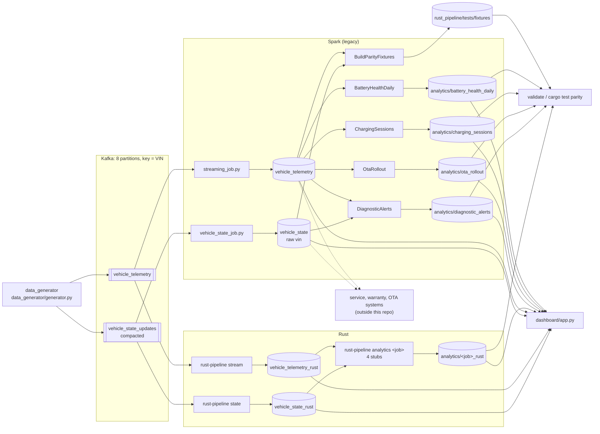

# Legacy pipeline dependencies

Companion to [inventory.md](inventory.md). The proposed slices built on this map are in
[migration-slices.md](migration-slices.md). `…/analytics/` means `spark_jobs/analytics/src/main/scala/telemetry/analytics/`.

## Data flow: Kafka topics to consumers

Where each edge comes from:

- **Producer:** `data_generator/generator.py:272-273`.
- **Streams:** `spark_jobs/streaming_job.py:186-247`, `spark_jobs/vehicle_state_job.py:160-172`, `rust_pipeline/src/consumer.rs:25-115`,
  `rust_pipeline/src/vehicle_state.rs:60-124`.
- **Analytics reads:** `…/analytics/BatteryHealthDaily.scala:43-44`, `ChargingSessions.scala:40-41`, `OtaRollout.scala:46-47`,
  `DiagnosticAlerts.scala:36-40`.
- **Analytics writes:** `…/analytics/AnalyticsJob.scala:86-91`.
- **Rust analytics:** inputs `rust_pipeline/src/analytics/mod.rs:82-88`, outputs `rust_pipeline/src/config.rs:229-231`.
- **Fixtures:** `…/analytics/BuildParityFixtures.scala:34-65`.
- **Parity:** `rust_pipeline/src/analytics/parity.rs:22-58`, `rust_pipeline/src/main.rs:80-114`.
- **Dashboard:** `dashboard/app.py:212-229`, `637-760`.
- **External readers:** "Delta Lake tables that downstream service, warranty and OTA systems read" (`README.md:5-7`). Those
  systems are not in this repository. The dashed edge is drawn from the README only; which tables they read is not recorded.

The solid Rust edge from `vehicle_state_rust` exists because `run` opens that table for every job, even though only
`diagnostic_alerts` queries it (`rust_pipeline/src/analytics/mod.rs:86-87`). In practice, `rust-pipeline analytics ota_rollout`
fails if `vehicle_state_rust` does not exist yet.

**No analytics job reads another analytics job's output.** All four read only stream tables (sources above). Inside the repository,
the analytics tables are read only by the dashboard and by parity checks.

## Analytics jobs: reads, writes and what they share

| Job | Reads (data) | Writes (data) | Shared code: Spark side | Shared code: Rust side | Shared data |
|-----|--------------|---------------|-------------------------|------------------------|-------------|
| `battery_health_daily` | `vehicle_telemetry`, `BATTERY` rows (`…/analytics/BatteryHealthDaily.scala:16`) | `analytics/battery_health_daily`, partitioned by `event_date` (`:10`) | `AnalyticsJob` trait, `Cli`, `Paths`, `Spark.session` (`…/analytics/AnalyticsJob.scala:9-97`); entry in `BuildParityFixtures.Jobs` (`…/analytics/BuildParityFixtures.scala:19-24`); one sbt project and jar (`spark_jobs/analytics/build.sbt`) | `Job` / `JOBS` / `summarize` / `run` / `write_output` (`rust_pipeline/src/analytics/mod.rs:28-111`); `rust_pipeline/src/analytics/parity.rs`; `rust_pipeline/src/validate.rs`; `rust_pipeline/src/config.rs:223-242`; `spark_round` (`rust_pipeline/src/transforms/rounding.rs:7`) | Input `vehicle_telemetry` and fixture `input/telemetry` (all 4 jobs) |
| `charging_sessions` | `vehicle_telemetry`, `CHARGING` rows with a session id (`ChargingSessions.scala:13`) | `analytics/charging_sessions`, partitioned by `session_date` (`:9`) | same | same | same |
| `ota_rollout` | `vehicle_telemetry`, `OTA` rows (`OtaRollout.scala:32`) | `analytics/ota_rollout`, unpartitioned | same | same | same |
| `diagnostic_alerts` | `vehicle_telemetry`, `DIAGNOSTIC` rows, **and `vehicle_state`** (`DiagnosticAlerts.scala:13-20`) | `analytics/diagnostic_alerts`, unpartitioned | same | same; also `sha256_hex` would fit here (`rust_pipeline/src/transforms/anonymized.rs:20`) | The above, plus `vehicle_state` / `vehicle_state_rust` and fixture `input/vehicle_state`. It is the only analytics reader of the raw VIN |

Every job also has entries outside its own files:

| Location | Lines |
|----------|-------|
| Dashboard registry | `dashboard/app.py:178-207` |
| Dashboard Fleet renderer, which depends on the output column names | `dashboard/app.py:662-760` |
| Demo loader partition map | `scripts/load_demo_data.py:35-40` |
| Rust partition test | `rust_pipeline/src/analytics/mod.rs:121-132` |

All of these already list all four jobs, so a port does not need to edit them.

### Shared Rust helpers that do not exist yet

The specs in [jobs/](jobs/) list Spark behaviours that DataFusion 43 does not reproduce. Several are needed by more than one job:

| Helper | Needed by | Exists today? |
|--------|-----------|---------------|
| Spark HALF_UP `round(col, scale)` usable inside DataFusion | all 4 | Only as a scalar `f64` function, `rust_pipeline/src/transforms/rounding.rs:7-28` |
| Spark-style `/`: double result, null on `/0` | `ota_rollout`, `diagnostic_alerts` (`charging_sessions` guards with `when`) | No |
| `max_by` / `min_by` with Spark null semantics | `charging_sessions`, `battery_health_daily` | No |
| ISO `event_time` → `timestamp[us, UTC]`, null on bad input | `charging_sessions`, `diagnostic_alerts` | Only a chrono parser inside the stream transform. It falls back to the Unix epoch instead of null (`rust_pipeline/src/transforms/time_dimensions.rs:38-60`) |
| Hex SHA-256 as a SQL function | `diagnostic_alerts` | Only as a Rust function, `rust_pipeline/src/transforms/anonymized.rs:20` |

`rust_pipeline/src/analytics/mod.rs:1-10` says "Porting a job only touches that job's file". A shared helper module breaks that
rule once: it adds a file plus one `pub mod` line in `rust_pipeline/src/analytics/mod.rs`. Whichever slice introduces a helper becomes a code dependency for
the later slices that reuse it.

## What can migrate independently, and what must move first

- **Already moved:** both streams have Rust ports with Kubernetes deployments (`deploy/k8s/telemetry-stream.yaml`,
  `deploy/k8s/vehicle-state-stream.yaml`). The Rust analytics read those Rust tables (`rust_pipeline/src/analytics/mod.rs:84-87`),
  so no stream work blocks any analytics port.
- **Independent of each other:** all four analytics ports. Each has its own file, its own fixture
  (`rust_pipeline/tests/fixtures/expected/<job>`), its own output table (`<job>_rust`, `rust_pipeline/src/config.rs:229-231`), and no
  data dependency on another job.
- **Extra prerequisite for `diagnostic_alerts` live runs:** `vehicle_state_rust` must be at parity with `vehicle_state`
  (`rust-pipeline validate --state`, `rust_pipeline/src/main.rs:106-113`). CI parity does not need this, because it uses the fixture.
- **Must move first:** the shared HALF_UP-round helper, because every job needs it. In practice it goes into the first slice. A
  helper used by two jobs (`max_by`, timestamp parsing) should land with the first of those jobs.
- **Must move last:** retiring Scala. `BuildParityFixtures` calls all four `summarize` functions
  (`…/analytics/BuildParityFixtures.scala:19-24`), and all four share one sbt project that CI compiles (`.github/workflows/ci.yml:50-65`).
  Deleting one Scala job breaks the build unless `BuildParityFixtures` changes in the same commit. It also removes the ability to
  regenerate that job's expected output.
- **Cutover is separate from porting.** Ports write new `_rust` tables, and Spark keeps writing its own. Switching readers (the
  dashboard, and the external systems in `README.md:5-7`) and stopping Spark runs is a later, deliberate step per job.
