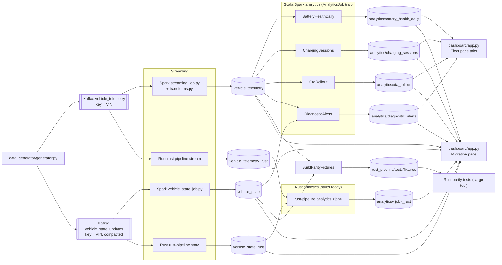

# Legacy dependencies and migration slices

Paths are relative to the repo root; `file:N-M` means lines N–M.
`scala/` = `spark_jobs/analytics/src/main/scala/telemetry/analytics/`.

## Data flow: Kafka to consumers

Sources: topics and producer `data_generator/generator.py:272-273`,
`docker-compose.yml:65-81`; streams `README.md:41-53`,
`spark_jobs/streaming_job.py:186-246`, `spark_jobs/vehicle_state_job.py:120-172`;
analytics inputs/outputs `scala/AnalyticsJob.scala:44-53,75-97` and each job's
`build` (`scala/BatteryHealthDaily.scala:43-44`, `scala/ChargingSessions.scala:40-41`,
`scala/OtaRollout.scala:46-47`, `scala/DiagnosticAlerts.scala:36-40`); Rust analytics
reads the `_rust` tables (`rust_pipeline/src/analytics/mod.rs:82-95`); fixtures
`scala/BuildParityFixtures.scala:19-63`, `rust_pipeline/src/analytics/parity.rs:22-58`;
dashboard Fleet tabs read the Spark analytics tables (`dashboard/app.py:178-226,662-760`),
Migration page compares Spark vs Rust tables (`dashboard/app.py:767-980`).
No analytics job reads another analytics job's output (each `build` only loads
`paths.telemetry` / `paths.vehicleState`, files above).

## What each analytics job reads, writes and shares

| Job | Reads (data) | Writes | Shared code (Spark) | Shared code (Rust) | Shares data with |
|---|---|---|---|---|---|
| `battery_health_daily` | `vehicle_telemetry` (`scala/BatteryHealthDaily.scala:43-44`) | `analytics/battery_health_daily`, partitioned `event_date` (`:10`) | `AnalyticsJob` trait, `BuildParityFixtures` (`scala/AnalyticsJob.scala:75-97`, `scala/BuildParityFixtures.scala:19-24`) | `analytics/mod.rs` registry/run, `parity.rs`, `validate.rs`, `transforms/rounding.rs` `spark_round` | Telemetry input with all other jobs; output read by dashboard battery tab (`dashboard/app.py:662`) |
| `charging_sessions` | `vehicle_telemetry` (`scala/ChargingSessions.scala:40-41`) | `analytics/charging_sessions`, partitioned `session_date` (`:9`) | same | same, plus a UTC `event_time` → timestamp parser (none on `main`) | Telemetry input; dashboard charging tab (`dashboard/app.py:693`) |
| `ota_rollout` | `vehicle_telemetry` (`scala/OtaRollout.scala:46-47`) | `analytics/ota_rollout`, unpartitioned | same | same (`spark_round` only) | Telemetry input; dashboard OTA tab (`dashboard/app.py:714`) |
| `diagnostic_alerts` | `vehicle_telemetry` **and** `vehicle_state` (`scala/DiagnosticAlerts.scala:36-40`) | `analytics/diagnostic_alerts`, unpartitioned | same | same, plus `event_time` parser and SHA-256 of `vin` (must match T6 `vin_hash`, `spark_jobs/transforms.py:169-176`) | Telemetry and vehicle-state inputs; dashboard diagnostics tab (`dashboard/app.py:732`) |

Shared code in detail:

- **Spark:** all four extend `AnalyticsJob` (`scala/AnalyticsJob.scala:75-97`) and are
  called by `BuildParityFixtures` (`scala/BuildParityFixtures.scala:19-24`). Each job's
  logic is otherwise self-contained in its own `summarize` (the four job files).
- **Upstream code they depend on indirectly:** every telemetry column they use other
  than raw event fields comes from `spark_jobs/transforms.py` (`model_safe` `:73`,
  `event_date` `:87`, `cell_temp_spread` `:117-118`, `thermal_alert` `:129-132`,
  `is_fault` `:133-137`, `vin_hash` `:173`). Those are already ported and
  parity-checked (`README.md:55-65`).
- **Rust:** dispatcher and job registry are pre-wired for all four
  (`rust_pipeline/src/analytics/mod.rs:9-10,49-78`); each job's code lives in its own
  file (`rust_pipeline/src/analytics/<job>.rs`). `spark_round` exists only as a scalar
  `f64` function (`rust_pipeline/src/transforms/rounding.rs`), not as a DataFusion UDF,
  and there is no shared `event_time` parser on `main`. Open PR #20
  (`devin/1794937836-spark-shared-helpers`) adds both
  (`rust_pipeline/src/transforms/rounding.rs`, `rust_pipeline/src/transforms/event_time.rs`
  on that branch).

## Independence and what moves first

- **All four jobs can be migrated independently of each other.** None reads another's
  output (diagram above), the Rust registry/dispatcher is already in place
  (`rust_pipeline/src/analytics/mod.rs:49-78`), and each parity test only covers its own
  job (`rust_pipeline/src/analytics/parity.rs:37-58`, called from each stub's ignored test,
  e.g. `rust_pipeline/src/analytics/ota_rollout.rs:19-26`).
- **Must move first:**
  1. The Rust streams that produce the inputs, because Rust analytics reads
     `vehicle_telemetry_rust` / `vehicle_state_rust` (`rust_pipeline/src/analytics/mod.rs:84-87`).
     Already done (`README.md:55-65`).
  2. A Spark-compatible rounding UDF: every job uses `round` (`scala/BatteryHealthDaily.scala:20,23,37-40`,
     `scala/ChargingSessions.scala:19,27-28,32-36`, `scala/OtaRollout.scala:24`,
     `scala/DiagnosticAlerts.scala:32`). Spark rounds HALF_UP on the decimal value of the
     double (`rust_pipeline/src/transforms/rounding.rs`), which a plain DataFusion `round`
     does not guarantee.
  3. For `charging_sessions` and `diagnostic_alerts` only: a UTC `to_timestamp(event_time)`
     equivalent (`scala/ChargingSessions.scala:16-17`, `scala/DiagnosticAlerts.scala:26-27`).
  4. For `diagnostic_alerts` only: `vehicle_state_rust` must be at parity with
     `vehicle_state` in the target environment (`validate --state`,
     `rust_pipeline/src/validate.rs:44-50`), because the job's fleet size and
     battery pack come from it (`scala/DiagnosticAlerts.scala:13-14,19-20`).
- **Must move last:** `BuildParityFixtures` and `AnalyticsJob.scala` (all jobs use them,
  `scala/BuildParityFixtures.scala:19-24`), the dashboard Fleet tabs' table paths
  (`dashboard/app.py:212-226`), and any production run of `<job>_rust`: there is no
  deployment for Rust analytics yet (`deploy/k8s/kustomization.yaml:9-13`).

## Migration slices

Every job slice follows the same pattern: implement `summarize` in the job's Rust file,
remove `#[ignore]` from its parity test (which is how the dashboard marks a job as
ported, `dashboard/app.py:461-468`), and pass `cargo test` against the committed
fixtures (`.github/workflows/ci.yml:14-36`). Spark keeps running and writing its own
table, so a slice can be reverted by restoring the stub.

| # | Slice | Files touched | Inputs | Spark-specific behaviour to reproduce | Why the boundary is safe |
|---|---|---|---|---|---|
| 0 | Shared Spark helpers | `rust_pipeline/src/transforms/rounding.rs`, `rust_pipeline/src/transforms/event_time.rs`, `rust_pipeline/src/transforms/mod.rs` (open PR #20) | – | HALF_UP decimal rounding; Spark string→timestamp cast | No job calls them yet; jobs only import helpers, so later slices stay single-file |
| 1 | `ota_rollout` | `rust_pipeline/src/analytics/ota_rollout.rs` | telemetry only, 5 columns | `row_number` latest-row pick, fixed-value pivot + `na.fill(0)`, `round` | Reads only telemetry; output read only by dashboard OTA tab; no timestamps, no partitions; needs only `spark_round` from slice 0 |
| 2 | `charging_sessions` | `rust_pipeline/src/analytics/charging_sessions.rs` | telemetry only, 10 columns | `to_timestamp`, timestamp→double, `min_by`/`max_by`, `when` without `otherwise`, `to_date` in UTC, partition by `session_date` | Reads only telemetry; independent output; needs `spark_round` + `event_time` |
| 3 | `battery_health_daily` | `rust_pipeline/src/analytics/battery_health_daily.rs` | telemetry only, 9 columns | `max_by`, `rangeBetween` window over seconds, `lag`, `round`, partition by `event_date` | Reads only telemetry; independent output; needs `spark_round` |
| 4 | `diagnostic_alerts` | `rust_pipeline/src/analytics/diagnostic_alerts.rs` | telemetry **and** vehicle state | `sha2` join key, left join, `countDistinct`, `dense_rank`, `to_timestamp`, fleet count from another table | Only job with two inputs; must wait for `vehicle_state_rust` parity in the target environment |
| 5 | Cut-over and retirement | `dashboard/app.py` (`:212-226` Fleet paths), new analytics deployment under `deploy/k8s/`, then `spark_jobs/analytics/` | – | – | Only after slices 1–4 pass; `BuildParityFixtures` needs all four Scala jobs until then |

Per-job details and risks: [`jobs/`](jobs/).

## Recommended first slice: `ota_rollout` (slice 1, with slice 0's rounding UDF)

- **Fewest inputs:** telemetry only, filtered to `event_type = 'OTA'`, 5 columns used
  (`scala/OtaRollout.scala:27-38`). `battery_health_daily` (9 columns) and
  `charging_sessions` (10) are also single-input; `diagnostic_alerts` needs two tables
  (`scala/DiagnosticAlerts.scala:36-40`).
- **Fewest Spark-specific behaviours:** a `row_number` window, a pivot over a fixed,
  explicit value list and `round` (`scala/OtaRollout.scala:11-44`). No timestamp parsing,
  no `min_by`/`max_by`, no range window, no output partitioning (compare
  `scala/ChargingSessions.scala:16-37`, `scala/BatteryHealthDaily.scala:25-40`).
  Its only shared dependency is `spark_round`.
- **Smallest output:** 6 rows in the committed fixture
  (`rust_pipeline/tests/fixtures/expected/ota_rollout/`), so a parity diff is easy to read.
- **Tie-break:** `battery_health_daily` is close on inputs, but has a range window, `lag`
  and `max_by`. Ownership is not recorded anywhere in the repo; per the migration request
  the OTA team owns `ota_rollout` and asked to go first, which points the same way.
- **End-to-end proof:** it exercises every step of the pattern: Rust `summarize`,
  un-ignored parity test in CI (`rust_pipeline/src/analytics/ota_rollout.rs:19-26`),
  `rust-pipeline analytics ota_rollout` and `validate --job ota_rollout` against live
  tables (`rust_pipeline/src/main.rs:77-96`), and the dashboard Migration status
  (`dashboard/app.py:461-468`).

Land slice 0 first, or with slice 1, so the OTA port does not need a job-local rounding
helper that later jobs would duplicate.
